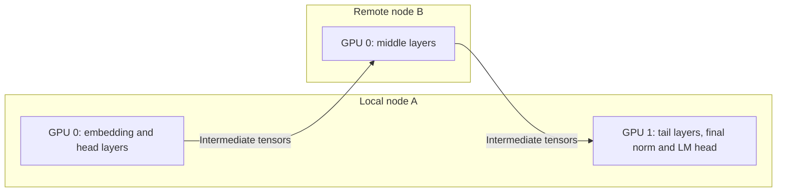

# Head-tail pipeline placement across nodes

Head-tail pipeline placement runs one model replica as an ordered pipeline,
with the first and last stages on a local node and the middle stages on other
nodes. It adds explicit or weighted transformer-layer partitioning, stage-to-node
placement, and an optional bounded asynchronous pipeline transport.

This is an experimental, opt-in feature. Current validation covers CPU
configuration, reference-model, and transport-protocol tests. Multi-node
GPU/NCCL validation and WAN performance measurements are still pending.

The objective is to use remote compute while controlling communication memory
and exposing opportunities to overlap communication with independent work.
Whether this helps a particular WAN deployment requires measurement: the
pipeline crosses its stage boundaries during both prefill and every decode step.
For enterprise burst capacity, long-input, short-output workloads are a useful
starting point: remote compute may amortize the communication cost. Interactive
long-output workloads repeatedly incur cross-node decode dependencies. Concurrent
batches can improve link utilization, while a single request still waits for its
own preceding stages.

## Architecture

For three pipeline stages with `tensor_parallel_size=1`:



Each stage owns a contiguous layer range and its corresponding KV cache. The
existing model implementation still determines which intermediate tensors are
sent, such as hidden states and residuals. This is pipeline parallelism within
one replica; it does not create separate prefill and decode instances or transfer
their KV caches through a KV connector.

Repeating node A in the placement list places two independent stages on that
node. Each stage uses distinct devices, with the same tensor-parallel size across
the pipeline. For TP size `T`, node A needs at least `2*T` available devices and
node B needs at least `T`. A folded executor that reuses the same device for the
head and tail is not implemented.

### Partitioning

Pass a JSON object with `--pipeline-partition-config`, or use the equivalent
nested mapping in a `vllm serve --config` YAML file.

| Field | Meaning |
| --- | --- |
| `head_layers` | Fixed number of transformer layers on the first stage; zero is allowed. |
| `tail_layers` | Fixed number of transformer layers on the last stage; zero is allowed. |
| `stage_compute_weights` | Positive relative compute capacities, one per stage. Larger values receive more work. |
| `layer_costs` | Positive relative cost for every transformer layer, in model order. |
| `stage_node_ips` | One Ray node address per pipeline stage; addresses may repeat. |

Setting either endpoint count fixes both endpoints; an omitted endpoint defaults
to zero. Fixed endpoints require at least three stages. Every middle stage must
receive at least one transformer layer, and the configured endpoints must leave
enough layers for those stages.

With no fixed endpoints, all stages receive at least one layer. Without
`layer_costs`, weights divide layer counts proportionally using constrained
largest-remainder allocation. Equal remainders prefer lower pipeline ranks.
With costs, the planner chooses contiguous boundaries near cumulative weighted
cost targets. It is a partitioning heuristic, not an optimal latency solver.
Fixed endpoints ignore their weights when distributing the remaining layers.

Weights and costs are user inputs, typically obtained from offline profiling.
There is no automatic hardware benchmarking, online weight adjustment, or
network-aware repartitioning. Profile the intended batch and context sizes, and
balance measured stage compute time rather than layer counts alone. Account
separately for embedding and LM-head work, per-stage KV memory, and link costs.

Do not combine this configuration with `VLLM_PP_LAYER_PARTITION`. Check the
`Resolved pipeline transformer layer counts` startup log before testing.

### Zero-transformer endpoints

With `head_layers: 0` and `tail_layers: 0`, stage 0 performs token embedding,
middle stages execute all transformer layers, and the last stage performs the
final normalization and LM head. The endpoints still require GPU memory and
compute; this is not a CPU-only frontend.

The zero-layer head embeds text token IDs, not images. Its intermediate-tensor
contract still sends hidden states and a full zero residual: the logical payload
is approximately `2 * T * H * dtype_bytes` for `T` scheduled tokens and hidden
size `H`, before metadata and backend overhead. No zero-residual wire compression
is implemented. Include both tensors when estimating the WAN traffic budget.

The initial zero-transformer scope is native dense `LlamaForCausalLM`,
`Qwen2ForCausalLM`, and `Qwen3ForCausalLM` text generation, with `enforce_eager`
enabled. It requires DP=PCP=DCP=1 and excludes expert parallelism, multimodal
models, KV/encoder disaggregation, KV offloading, and microbatching/DBO.
Positive-layer partitions retain the model's ordinary pipeline-parallel support
requirements. Both new partition and transport configurations currently reject
speculative decoding.

Local embedding is not a privacy boundary. Native scheduler messages still
distribute token IDs, and intermediate representations may contain sensitive
information. Use the existing
[distributed deployment network requirements](../serving/parallelism_scaling.md#ray-cluster-setup-with-containers)
for the cluster's trusted connectivity.

### Bounded asynchronous transport

Enable the transport independently with:

```json
{
  "enabled": true,
  "max_inflight_sends": 2,
  "max_inflight_bytes": 268435456,
  "async_receive": true
}
```

The transport retains a snapshot of outgoing intermediate tensors until the
corresponding send completes. This avoids a later forward pass overwriting
buffers that communication still reads. Both pending-send count and retained
tensor bytes are bounded per worker transport; reaching a limit applies
backpressure. A single payload larger than the byte budget is rejected before
posting, so size this budget for the largest scheduled batch. These limits do
not bound total GPU memory, model state, receive buffers, or backend allocations.

With `async_receive: true`, receiving returns a ticket before tensor metadata has
arrived. The model runner can perform independent preparation before consuming
the incoming tensors. Consumption still waits for the matching transfer. The
transport preserves FIFO order and does not run a later ready batch ahead of an
earlier delayed batch.

This reuses native chunked-prefill and pipeline execution queues. It does not
increase engine scheduling depth, add a new request scheduler, or remove a
decode step's data dependencies. Overlap can cover some communication waiting
when independent work exists; RTT, bandwidth, and the transport backend's
retransmissions remain relevant. This layer does not implement packet repair.
Scheduler/control traffic and the model runner's sampled-token feedback retain
their existing paths; only pipeline intermediate-tensor transport is changed.

The transport currently requires the CUDA/ROCm GPU worker, the V2 model runner,
and the multiprocessing or Ray V2 executor. Set `VLLM_USE_V2_MODEL_RUNNER=1` and
use a platform/model combination that supports that runner. CPU execution,
KV/encoder disaggregation, KV offloading, and microbatching/DBO are excluded when
transport is enabled. Transport errors propagate to the worker/executor; this
feature does not provide session replay after failure. Partitioning without this
transport can still use the V1 model runner.

## Configuration and launch

The runnable templates are in
[examples/features/head_tail_pipeline](../../examples/features/head_tail_pipeline/README.md).
They use `Qwen/Qwen2.5-0.5B-Instruct`, TP=1, PP=3, eager execution, and native
chunked prefill. The small model is for configuration and correctness checks;
it is not evidence of a WAN performance benefit.

1. Prepare a Ray cluster using the same vLLM revision and model files on all
   nodes. Follow the [multi-node deployment guide](../serving/parallelism_scaling.md#multi-node-deployment).
   Verify the available GPUs and the exact `NodeManagerAddress` values with Ray.
2. Replace the example node addresses in the selected YAML with those addresses.
   Stage placement requires the Ray executor and one whole device per worker;
   leave `VLLM_RAY_PER_WORKER_GPUS=1` and do not set
   `VLLM_RAY_BUNDLE_INDICES` at the same time.
3. Launch one server against the running cluster:

    ```bash
    VLLM_USE_RAY_V2_EXECUTOR_BACKEND=1 VLLM_USE_V2_MODEL_RUNNER=1 \
        vllm serve --config examples/features/head_tail_pipeline/explicit.yaml
    ```

| Template | Partition for the example 24-layer model |
| --- | --- |
| [`explicit.yaml`](../../examples/features/head_tail_pipeline/explicit.yaml) | `[2, 20, 2]`: fixed head and tail. |
| [`weighted.yaml`](../../examples/features/head_tail_pipeline/weighted.yaml) | `[4, 16, 4]`: weights `[1, 4, 1]`, no fixed endpoints. |
| [`encoding_only.yaml`](../../examples/features/head_tail_pipeline/encoding_only.yaml) | `[0, 24, 0]`: embedding and output-head endpoints. |

For a different model, verify its transformer-layer count and the resolved
partition. The YAML filename `encoding_only` refers to the first stage's token
embedding role; it does not enable multimodal encoder disaggregation.

The equivalent partition and transport CLI options are:

```bash
--pipeline-parallel-size 3 \
--pipeline-partition-config '{"head_layers":2,"tail_layers":2,"stage_node_ips":["10.0.0.10","10.0.0.20","10.0.0.10"]}' \
--pipeline-transport-config '{"enabled":true,"max_inflight_sends":2,"max_inflight_bytes":268435456,"async_receive":true}'
```

For a single-node smoke check, repeat that node's Ray address three times and
provide three distinct GPUs. To test partitioning without the new transport,
set `pipeline-transport-config.enabled: false` in a copy of the YAML.

## Correctness and performance validation

First run the CPU configuration, placement, and transport tests in a prepared
development environment. These validate planning and protocol behavior without
establishing GPU model correctness or WAN performance:

```bash
.venv/bin/python -m pytest \
    tests/config/test_pipeline.py \
    tests/config/test_pipeline_integration.py \
    tests/utils_/test_ray_utils.py \
    tests/distributed/test_pp_transport.py -q
```

Then validate on the target GPU cluster:

1. Compare deterministic generations with an unsplit reference using identical
   weights, dtype, prompts, sampling parameters, and context limits. Exercise
   short prompts, multiple prefill chunks, concurrent requests, cancellation,
   and requests near the context limit. Compare token outputs and investigate
   numerical differences with log probabilities or model evaluation.
2. Run the same partition with the new transport disabled and enabled. Check
   that no request receives stale intermediate data as buffers are reused.
   Exercise a batch near the configured byte budget and verify oversized
   batches fail clearly rather than hang.
3. Confirm stage-to-node placement and distinct GPU allocation. For zero-layer
   endpoints, verify that the middle stage owns the attention/KV layers and
   that first/last stages perform their embedding/output roles.
4. Test link delay, constrained bandwidth, and transport failure on an isolated
   test network. Record the actual path and backend; host TCP shaping does not
   necessarily affect an RDMA path. A failed run must terminate visibly rather
   than silently reusing buffers or producing another request's output.

Use `vllm bench serve` for end-to-end measurements, for example:

```bash
vllm bench serve \
    --backend vllm \
    --model Qwen/Qwen2.5-0.5B-Instruct \
    --base-url http://127.0.0.1:8000 \
    --endpoint /v1/completions \
    --dataset-name random \
    --random-input-len 4096 \
    --random-output-len 128 \
    --num-prompts 200 \
    --request-rate 2 \
    --max-concurrency 8 \
    --percentile-metrics ttft,tpot,itl,e2el \
    --metric-percentiles 50,95,99 \
    --save-result \
    --result-filename head-tail.json
```

Sweep prompt length, output length, offered load, chunk size, partition, and
send budgets while holding the model and hardware constant. Compare local
execution where feasible, ordinary PP, and each head-tail variant. Use separate
result filenames and separate cold-cache and warm-cache runs. If evaluating
goodput, supply workload-specific `--goodput ttft:<ms> tpot:<ms>` thresholds;
average TPOT does not replace tail ITL measurements.

Report TTFT, TPOT and tail ITL, successful requests per second, errors, device
memory, per-stage utilization, link throughput, and actual RTT. Capture a
timeline to establish whether communication overlaps useful compute. The
configuration weights and budgets are tuning inputs; no speedup, WAN distance,
or loss tolerance is promised by these examples.
